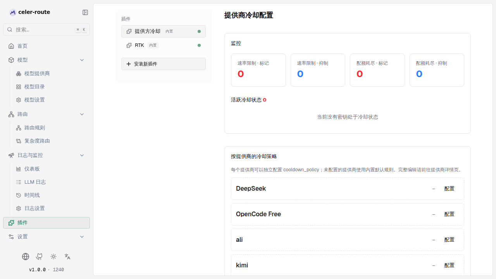
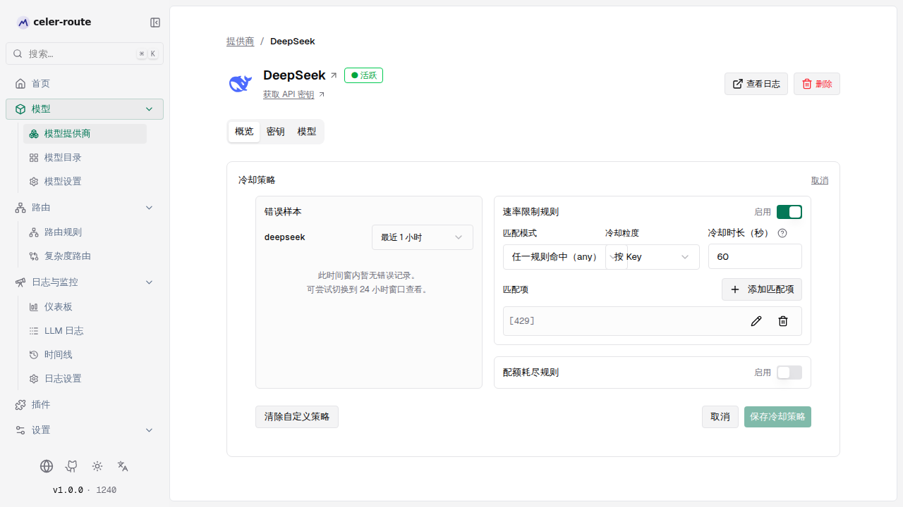

# 提供商冷却

**提供商冷却（Provider Cooldown）**是 celer-route 内置的一项自动化保护：当某个
提供商密钥返回配额耗尽或限流错误时，插件会把它**暂时移出密钥池**，让后续请求
自动改走其他健康密钥，而不是反复撞同一堵墙。冷却时长到期后，密钥自动恢复。

你不需要写任何配置文件——所有操作都可以在 Web UI 中完成：

- **监控**：实时查看哪些密钥正在冷却、为何冷却、何时恢复
- **解除冻结**：觉得某个密钥恢复时机不对时，手动一键解除
- **按提供商配置规则**：决定什么样的错误触发冷却、冷却多久、按 Key 还是按模型
- **按提供商开关高级能力**：冷却时长自适应升级、回溯式容量闸门、限额学习，都可以
  在提供商详情页单独启用或关闭，并在同一页看到当前的窗口用量与学习建议

## 工作原理

| 环节 | 说明 |
|------|------|
| **什么会触发冷却** | 请求失败后，插件对错误的**消息、编码、类型**做不区分大小写的匹配（内置模式：`insufficient_quota`、`quota exceeded`、`quota_exceeded`、`billing`、`usage limit`），并受状态码约束：HTTP 429 及其他 4xx 在文案命中时触发；**HTTP 402 与 5xx 永不触发**。 |
| **冷却期间的影响** | 触发失败的 `(provider, key)` 在冷却时长（默认 300 秒）内被跳过选钥，请求落到同一提供商的其他健康密钥，再按顺序回退到其他提供商。若所有可用密钥都在冷却，请求返回合成错误 `429 no_eligible_keys`，并带 `Retry-After` 响应头提示最早可重试的时间。 |
| **如何恢复** | TTL 到期自动恢复，无需人工干预。冷却状态存放在**进程内存**中，重启 celer-route 会清空全部冷却记录。 |

## 启用 / 停用冷却

进入 **左侧边栏 → 插件**，选择 **提供方冷却**：

1. 找到 **启用提供商冷却** 开关，打开即可启用（默认已启用）
2. 关闭开关即全局停用



## 监控冷却状态

插件页的 **监控** 面板每 5 秒自动刷新，两块内容：

**统计卡片**（4 个计数）
- **速率限制 · 标记 / 抑制**、**配额耗尽 · 标记 / 抑制**
- *标记* = 累计触发的次数；*抑制* = 累计被拦截（跳过选钥）的请求数

**活跃冷却状态**
- 列出当前正在冷却的每个条目：提供商、密钥 ID、冷却原因（速率限制 / 配额耗尽）、
  **过期时间**（本地时区 + 相对倒计时）
- 每个条目右侧有 **解除冻结** 按钮，点击后该密钥立即回到密钥池，无需等 TTL 到期
  （keyless 提供商不显示该按钮）

## 配置冷却策略

冷却规则是**按提供商独立配置**的。每个提供商要么使用**内置默认策略**（开箱即用，
无需任何配置），要么自定义。

### 进入方式

- **方式一**：插件页 → **按提供商的冷却策略** 列表，点该提供商的 **配置冷却**，
  会直接跳到提供商详情页的 **冷却策略** 标签
- **方式二**：**左侧边栏 → 模型提供商** → 进入某提供商详情页 → **冷却策略** 标签

冷却策略、以及下文三项高级能力，都只在这一个地方编辑；插件页不再提供按提供商的
规则编辑表单。



### 表单结构

**错误样本（左栏）** —— 不用猜错误长什么样
- 时间窗切换 **最近 1 小时 / 最近 24 小时**，列出该提供商此前的真实错误
- 每条错误样本可点 **应用**，选择加入 *速率限制规则* 或 *配额耗尽规则*，
  自动生成匹配项（状态码 / 错误类型 / 错误代码 / 消息片段）

**规则编辑器（右栏）** —— 速率限制规则 + 配额耗尽规则，每条规则包含：

| 字段 | 说明 |
|------|------|
| **启用** | 开关；两个开关都关闭（或全部留空）保存后，即回退到内置默认策略 |
| **匹配模式** | 任一规则命中（any）/ 所有规则都命中（all） |
| **冷却粒度** | **按 Key**（默认）：一次命中冷却整个 `(provider, key)`。**按模型**：只冷却 `(provider, key, model)`，适合提供商按模型分别限流（如按模型 TPM/RPM），避免一个模型打满拖垮同 key 的其他模型 |
| **冷却时长（秒）** | 命中后进入冷却的秒数（1–86400），冷却期间不会被选钥 |
| **匹配项** | 一条或多条匹配条件，命中即触发：HTTP 状态码、消息包含、错误类型、错误代码；点 **+ 添加匹配项** 增加，铅笔图标编辑，删除图标移除 |

**能力卡片（表单下半部分）** —— **冷却时长自适应升级**、**回溯式容量闸门**、
**限额学习（只读）** 三张卡片。每张都是三态（**继承全局默认 / 自定义 / 关闭**），
卡片上会显示「当前生效」的摘要；容量闸门卡片下方还有该提供商的 **学习建议**。各能力
的含义见下文对应章节。

### 参考提供商返回的重试时间

默认情况下，命中规则后冷却多久完全由 **冷却时长（秒）** 决定。冷却策略还提供了一
个可选项，让冷却时长参考提供商在失败响应里给出的「请稍后再试」提示：

- **取较小值**：在「提供商提示」和「冷却时长」之间取较短的一个。提示只能缩短冷却，
  不会超过你配置的时长；提供商没有给出可用提示时，仍按冷却时长执行。
- **完全采用提示**：直接按提供商提示的时长冷却；没有提示时回退到冷却时长。

这两档都是**逐条规则**生效的——限流规则与配额规则各自独立设置，其余规则不受影响。
默认（不启用）时行为与以前完全一致，固定按冷却时长冷却。

:::note 选用前先权衡
提供商给出的提示通常只覆盖当前这一小段窗口。对配额/套餐耗尽这类需要长时间恢复的
情况，「完全采用提示」可能把原本较长的冷却缩短，让密钥过早回到池子、再次撞墙。拿不
准时保持默认即可。
:::

### 保存与回退

- **保存冷却策略**：应用自定义策略；保存后插件页的列表会展示该提供商的规则摘要与
  实时统计
- **清除自定义策略**：一键恢复内置默认策略
- 规则编辑借助 Zod 校验，非法输入会就地提示，无法保存

## 内置默认策略

任何提供商在未自定义策略时，都会套用针对其错误语义调校过的内置默认值——例如
OpenAI 限流冷却 60 秒、配额冷却 600 秒；Anthropic / Gemini / Vertex 限流冷却
60 秒；通用默认 300 秒。**开箱即有保护，无需配置。**

:::warning 配额规则不要只填状态码 429
配额规则**先于**限流规则被检查。如果配额规则只填「HTTP 状态码 = 429」，它会把
每一次限流错误也当成配额耗尽，限流规则就永远命中不到——表现为监控页里的失败
几乎全被标成「配额耗尽」。配额规则至少要再补一项「消息包含 / 错误类型 / 错误
代码」，例如只匹配 `insufficient_quota` 或 `entitlement exhausted`。

保存时后端会拒绝这种只填状态码的配额规则，规则编辑框也会就地提示，无法保存。
:::

## 这些配置放在哪里

冷却相关配置分成两层：**提供商级**只影响一个提供商，**插件级默认值**只对没有单独
配置的提供商生效。

| 配置项 | 位置 | 作用范围 |
|------|------|------|
| 冷却规则（速率限制 / 配额）、冷却粒度、是否参考提供商返回的重试时间 | 提供商详情页 → **冷却策略** 标签 | 只对该提供商生效 |
| 冷却时长自适应升级、限额学习 | 提供商详情页 → **冷却策略** 标签 → 对应的卡片 | 只对该提供商生效 |
| **回溯式容量闸门** | **只有提供商级**：提供商详情页 → **冷却策略** → **回溯式容量闸门** | 只对该提供商生效；插件页不提供容量默认值 |
| 升级与学习的默认值 | 插件页 → **舰队默认策略**（按钮 **保存默认策略**） | 仅对**未单独配置**的提供商生效 |
| 舰队容量水位（只读） | 插件页 → **舰队容量水位** | 跨提供商的实时用量监控，不可编辑 |
| 默认 TTL、TTL 覆盖、配额模式 | 插件页 → **冷却设置** | 全局默认 |
| 每 Key 在途并发上限 | 提供商详情页 → **高级 → 性能** | 只对该提供商生效 |

三项能力在提供商级都是**三态**的，卡片右上角的三个按钮分别对应：

| 状态 | 写进 `cooldown_policy` 的内容 | 含义 |
|------|------|------|
| **继承全局默认** | 不写该段 | 升级与学习沿用插件页 **舰队默认策略** 里的同名段；容量闸门没有全局默认值，因此该段缺失时容量闸门不生效（除非配置里仍留有下文所述的遗留全局容量配置） |
| **关闭** | `{ "enabled": false }` | 明确为该提供商关闭，即使插件级默认是开启的 |
| **自定义** | 完整的一段配置 | 整段覆盖插件级默认值，卡片会同时显示「当前生效」的摘要 |

:::warning 整段替换，不做字段级合并
提供商段一旦存在，**整段**替换插件级默认值——不会把两边的字段逐项合并。例如插件级
`capacity` 配了 `token_limit` 和 `headroom`，某个提供商只自定义了 `token_limit`，
那么该提供商的 `headroom` 取的是内置默认值 `0.9`，而不是插件级的值。切换成
**自定义** 时表单会以「当前生效」的值为起点，避免从空值开始编辑。

同理，提供商详情页保存冷却策略时，`cooldown_policy` 是**整对象替换**（PUT 语义）：
表单里没有的段不会保留旧值，需要「继承」的段就保持缺失。
:::

:::note 范围校验
保存时会按段校验取值范围：`window_seconds` 只接受 `10`–`3600`（或 `0` 表示使用默认
值 `60`），`headroom` 只接受 `0.1`–`1.0`，`max_multiplier` 只接受 `1`–`16`，样本数
各有自己的区间。越界会被写接口拒绝，错误形如：

```
Invalid provider configuration: cooldown_policy.capacity.window_seconds must be between 10 and 3600 (or 0 for the default 60), got 1
```
:::

## 冷却时长自适应升级（可选，默认关闭）

默认情况下，同一个密钥每次被限流的冷却时长都是一样的。如果希望**反复撞墙的密钥
自动退避得更久**，可以开启自适应升级。它只是在命中规则算出的冷却时长上做放大，
不会阻塞请求、不会等待，也不会改变发往提供商的请求内容。

开启后有两种放大方式，可以同时生效：

| 情形 | 行为 |
|------|------|
| **同一个密钥反复被限流** | 在 5 分钟窗口内，同一 `(提供商, 密钥, 模型)` 每再失败一次，冷却时长就翻倍：1× → 2× → 4× ……，直到达到配置的上限。中间只要成功一次，计数立刻清零，下次重新从 1× 开始 |
| **多个密钥同时被限流** | 如果 60 秒内有 3 个及以上**不同密钥**在同一提供商/模型上被限流，说明更可能是上游整体吃紧，继续换密钥意义有限。此时**新产生**的冷却会直接从 2× 起步；等这段时间不再有新密钥失败，信号自动消失，恢复 1× |

为防异常情况下把密钥越锁越久，升级后的冷却时长最多为 **1 小时**。

**默认关闭**：不配置时，冷却时长完全按规则里的「冷却时长」或重试提示计算，行为
与未引入该能力时完全一致。

### 启用方式

推荐在 **提供商详情页 → 冷却策略 → 冷却时长自适应升级** 卡片里配置。三个按钮分别
是 **继承全局默认 / 自定义 / 关闭**；选 **自定义** 后填写 **最大倍数** 即可，保存
冷却策略后对该提供商生效。

如果希望所有未单独配置的提供商共享一份设置，可以在插件页的 **舰队默认策略** 里开启，
也可以直接写 `config.json`。下面是 `config.json` 的写法（即插件级默认值）：

```json
{
  "plugins": [
    {
      "name": "provider-cooldown",
      "enabled": true,
      "config": {
        "default_ttl_seconds": 300,
        "ttl_overrides": {},
        "quota_patterns": ["insufficient_quota"],
        "escalation": {
          "enabled": true,
          "max_multiplier": 4
        }
      }
    }
  ]
}
```

> 这是**默认值**：被提供商级 `escalation` 覆盖的提供商不适用。`default_ttl_seconds`、
> `ttl_overrides`、`quota_patterns` 是该插件配置的既有必填项，即使本次只关心
> `escalation` 也要一并保留（保持你当前使用的值即可）。

- `enabled`：开关，默认 `false`
- `max_multiplier`：单个密钥最多放大到几倍，默认 `4`，合法范围 `1`–`16`，
  超出范围会被夹到边界

:::note 适合什么场景
如果监控页里同一个密钥频繁出现「速率限制」，或同一提供商下多个密钥几乎同时被
限流，开启升级通常比手动调大固定冷却时长更省事。若你的提供商限流是按固定周期
恢复、且你已用「参考提供商返回的重试时间」精确控制时长，保持关闭即可。
:::

## 我们自己的预算闸门（可选，默认关闭）

冷却和并发上限解决的都是**撞墙之后**的问题。如果你想在**自己这一侧**再上一道保险，
可以开启**回溯式预算闸门（capacity gate）**：当一段时间内我们发给某个提供商的流量
已经花掉了预设预算，**后续**请求就不再发出，直接返回 `429`（或交给 fallback 链）。

:::warning 它衡量的是「我们自己的预算」，不是提供商的限额
提供商声明的 TPM/RPM 是它们自己的口径。这个闸门只看**我们统计到的真实用量**，
用来防止单点提供商被打爆，或用来给某个提供商设一个内部用量上限。它**不能**替代
提供商侧的限流，也不保证「一定不会被提供商 429」。
:::

### 为什么必须按提供商配置

预算本质上是**套餐配额**，而不同提供商的配额差异很大：有的按月给几百万词元，有的
只有几十万，同一个「每分钟词元上限」对前者永远触发不了、对后者又会一开始就拦截。
改造前只有一个全局 `token_limit`，实际上只能取「最保守的那个提供商」的值，等于让
高配额提供商白白浪费余量。所以容量闸门必须能按提供商分别取值：在提供商详情页按套餐
填，其余提供商再沿用插件级默认值兜底。

### 为什么是「回溯式」

闸门**不估算词元，也不读取请求体**。它只统计真实发生的用量：

- 成功请求：按响应里的词元用量记账；
- 失败但已被计费的请求：按错误里携带的已计费用量记账；
- 取不到用量时：词元记 0，但请求数照常 +1。

因此跨过阈值的那一个请求仍然会发出去（和被动冷却的取舍一致），换来的是**零估算
误差**和**可解释的阈值**。

### 启用方式

只支持**按提供商**配置：在 **提供商详情页 → 冷却策略 → 回溯式容量闸门** 卡片里：

- **继承全局默认**：不写该段。容量闸门没有插件级默认值，所以该提供商不启用闸门；
- **关闭**：该提供商不设闸门
- **自定义**：填写上限、窗口、余量、统计粒度与耗尽后的处理方式，保存后生效

:::note 旧版全局容量配置属于遗留兼容
早期版本可以在插件页设置一份**全局** `capacity` 默认值，或直接写进 `config.json`。这个入口
已经移除——一份全局 `token_limit` 无法同时适配不同提供商的套餐配额。旧配置仍然会被读取，
并对**未单独配置容量**的提供商继续生效（避免升级后悄悄放开闸门）。

如果配置里仍留有这一段，插件页的 **舰队默认策略** 区块顶部会出现一条提示，显示它的当前
生效摘要，并提供 **清除全局默认** 按钮。清除前请先确认这些提供商都已在提供商详情页
配置了自己的容量闸门，否则它们会变成「未配置（不生效）」。

下面是这段遗留配置的写法，仅用于理解现有部署，不建议新增：

```json
{
  "plugins": [
    {
      "name": "provider-cooldown",
      "enabled": true,
      "config": {
        "default_ttl_seconds": 300,
        "ttl_overrides": {},
        "quota_patterns": ["insufficient_quota"],
        "capacity": {
          "enabled": true,
          "token_limit": 200000,
          "request_limit": 500,
          "window_seconds": 60,
          "headroom": 0.9,
          "scope": "provider",
          "action": "fallback"
        }
      }
    }
  ]
}
```

> 这是**遗留兼容**的默认值：只在提供商没有自己的 `capacity` 段时生效，UI 不再提供编辑
> 入口。`default_ttl_seconds`、`ttl_overrides`、`quota_patterns` 是该插件配置的既有
> 必填项，改动时要一并保留。

这一段各字段的含义（`enabled` 默认 `false`，`token_limit` / `request_limit` 至少填一个）：

| 字段 | 默认 | 说明 |
|------|------|------|
| `enabled` | `false` | 关闭时完全绕过：不建状态、不加锁、不拦截 |
| `token_limit` | `0` | 每窗口词元上限；`0` 表示不限 |
| `request_limit` | `0` | 每窗口请求数上限；`0` 表示不限 |
| `window_seconds` | `60` | 滑动窗口长度，合法范围 `10`–`3600` |
| `headroom` | `0.9` | 用量达到 `上限 × headroom` 即触发闸门，合法范围 `0.1`–`1.0` |
| `scope` | `"provider"` | `"provider"`：同一提供商的全部模型共享一份预算；`"provider_model"`：每个「提供商 + 模型」各有一份 |
| `action` | `"fallback"` | `"fallback"`：交给 fallback 链继续尝试；`"reject"`：直接拒绝，不再回退 |

### 当前窗口用量怎么看

**在 Web UI 里**有两种视图：

- **插件页 → 舰队容量水位**：跨提供商的只读监控表，列出当前窗口内有记账的每个
  「提供商（或提供商 + 模型）」：词元与请求的 `已用 / 阈值`、窗口长度、是否已触发、
  以及来源（`本提供商` / `遗留全局默认`）。点提供商名可直接跳到它的 **冷却策略** 标签。
  这张表**只读**，不能在这里修改任何上限。
- **提供商详情页 → 冷却策略 → 容量水位**：只看当前提供商（在用量卡下方）。每一行是
  一个统计口径——`scope = provider` 时只有一行「全部模型」，`provider_model` 时每个
  模型一行。

提供商卡片行内显示：

- **来源徽章**：`默认值` 表示用的是遗留的插件级默认段，`本提供商` 表示这是提供商自己的段
- **窗口**：该行的滚动窗口长度（秒）
- **词元 / 请求**：当前窗口已用量 / 实际触发阈值（`上限 × 余量`）与百分比进度条
- 已经越过阈值时，额外提示 **约 N 秒后放行**

没有启用闸门（或窗口内没有流量）时卡片显示空态；该提供商明确关闭了闸门时显示
「当前提供商已关闭容量闸门」。

**通过接口**（只读，便于接监控）：

```
GET /api/plugins/provider-cooldown/capacity-usage
```

```json
{
  "plugin": "provider-cooldown",
  "count": 1,
  "entries": [
    {
      "provider": "openai",
      "scope": "provider",
      "window_seconds": 60,
      "used_tokens": 152300,
      "used_requests": 312,
      "token_limit": 200000,
      "request_limit": 500,
      "headroom": 0.9,
      "threshold_tokens": 180000,
      "threshold_requests": 450,
      "retry_after_seconds": 0,
      "source": "provider"
    }
  ]
}
```

| 字段 | 含义 |
|------|------|
| `provider` / `model` | 统计对象；`scope = provider` 时没有 `model`，表示该提供商的全部模型共用一份预算 |
| `scope` | `provider`（跨模型共享）或 `provider_model`（按模型独立） |
| `window_seconds` | 该行的滚动窗口长度 |
| `used_tokens` / `used_requests` | 当前窗口内已记账的真实用量 |
| `token_limit` / `request_limit` | 配置的上限，`0` 表示不限 |
| `headroom` | 配置的余量比例 |
| `threshold_tokens` / `threshold_requests` | 闸门实际比较的阈值，即 `上限 × headroom`；`0` 表示该项不限 |
| `retry_after_seconds` | 建议再等多少秒窗口用量才会回落到阈值以下；`0` 表示当前未被拦截 |
| `source` | 该段配置的来源：`provider` = 提供商自己的 `cooldown_policy.capacity`，`default` = 插件级默认段 |

只返回窗口内仍有记账的条目——某个提供商的窗口完全滑走之后就不再出现。该接口不改变
任何状态。

### 触发后的表现

- 返回 `429`，错误类型为 `rate_limit_exceeded`（与「所有密钥都在冷却」的
  `no_eligible_keys` 明确区分），消息里写明提供商/模型、窗口长度和建议重试秒数。
- 响应头带 `Retry-After`，值是**最早能让窗口用量回落到阈值以下**的秒数。
- `action` 为 `fallback` 时允许 fallback 链接手；为 `reject` 时立即拒绝。

### 行为边界

- **被闸门拒绝的请求不计入预算**，否则拒绝会不断延长它自己造成的窗口。
- 只统计**真正发往提供商**的请求：本插件自身的短路、冷却导致的「无可用密钥」短路、
  缓存命中都不会记账。
- 流式响应只在**最后一个数据块**记账一次；如果一个流在没有结束标记的情况下中断，
  这一次不会被记账（用量未知，宁可少记也不猜）。
- 状态保存在**进程内存**中：按秒分桶、过期桶懒清除；进程重启即清空。多实例部署时
  每个实例各自统计。

## 自动学习上游限额（可选，默认关闭）

前面两节都是**我们自己这一侧**的规则：闸门管的是自己的预算，升级管的是冷却
时长。这一节反过来：**从上游的限流反馈里，反推上游真实的限额**，并给出一个
带置信度的建议值。

:::warning 它只给建议，绝不会替你改配置
学习器是**只读**的：它不写冷却策略、不写闸门阈值、不动任何配置项。产出的只有
一份报告——由你决定要不要采纳、采纳到哪个值。
:::

### 为什么需要它

用我们自己的请求速率或词元速率**拟合**不出上游限额：实测下来，无论是自然
分钟还是滚动 60 秒窗口，都看不到明显的悬崖，同一分钟里的第 1 个请求就有约
24.7% 的概率被拒。

但**被拒的那一刻本身**带着信息：上游拒绝时，窗口里已经消耗掉了多少真实
词元是可以统计的，而这次被拒的请求如果被接受又会再消耗多少。于是上游的有效
限额就被夹在一个区间里：

```
[ 拒绝时窗口内已消耗的词元 , 已消耗 + 本次请求自身的词元 ]
```

多次观测取中位数，就得到一个稳健的估计值。

### 它学的是什么、怎么学

- **只看限流，不看配额**：只有被判定为**速率限制**的 429（HTTP 429 且被提供商的
  冷却规则归类为限流）才会成为样本。配额 / 套餐耗尽（`insufficient_quota` 之类）
  反映的是余额或权益，不是窗口限额，一律**不采样**——否则会把「余额用完了」误
  学成「TPM 限额很低」。
- **只用真实用量**：样本里的「已消耗词元」来自上游真实回报的用量（失败但已计
  费的尝试用其已计费用量），**不做任何词元估算**。取不到就是 0，此时区间
  退化为一个点，估计值会偏保守。
- **按「提供商 + 模型」分别学习**：每个组合各有一份样本与一个估计值。
- **样本有上限**：每个组合只保留最近若干条样本，超出时丢弃最旧的。

### 怎么开启

推荐在 **提供商详情页 → 冷却策略 → 限额学习（只读）** 卡片里配置：

- **继承全局默认**：跟随插件级默认值（插件默认未开启时，该提供商不学习）
- **关闭**：该提供商不采样
- **自定义**：分别设置窗口、最大样本数、最小样本数，保存后生效

每张卡片下方会列出该提供商当前的学习建议（见下文「怎么看结果」）。

如果希望所有未单独配置的提供商都用同一份设置，可以在插件页的 **舰队默认策略** 里开启，
或直接写 `config.json`。下面是 `config.json` 的写法（即插件级默认值）：

```json
{
  "plugins": [
    {
      "name": "provider-cooldown",
      "enabled": true,
      "config": {
        "default_ttl_seconds": 300,
        "ttl_overrides": {},
        "quota_patterns": ["insufficient_quota"],
        "learning": {
          "enabled": true,
          "window_seconds": 60,
          "max_samples": 50,
          "min_samples": 5
        }
      }
    }
  ]
}
```

> 这是**默认值**：被提供商级 `learning` 覆盖的提供商不适用。`default_ttl_seconds`、
> `ttl_overrides`、`quota_patterns` 是该插件配置的既有必填项，即使本次只关心
> `learning` 也要一并保留。

| 字段 | 默认 | 说明 |
|------|------|------|
| `enabled` | `false` | 关闭时完全绕过：不建状态、不加锁、不采样 |
| `window_seconds` | `60` | 观测窗口长度，合法范围 `10`–`3600`。窗口应与上游限额的窗口同量级（60 秒对应 TPM，不是天配额）。每个提供商可以在自己的 `learning` 段里用不同的窗口 |
| `max_samples` | `50` | 每个「提供商 + 模型」保留的样本数，合法范围 `5`–`500`，超出丢弃最旧的 |
| `min_samples` | `5` | 达到多少个样本才给出估计值，合法范围 `1`–`100` |

### 怎么看结果

**在 Web UI 里**：提供商详情页 → **冷却策略** → **限额学习（只读）** 卡片底部会列出
该提供商的「学习建议」，每一条显示模型、样本数、估算窗口、估算上限与置信度。如果该
估算的窗口和容量闸门当前的窗口不一致，列表会提示两者不能直接通用。

每条建议右侧有 **采用为上限** 按钮。它只是把估算值**预填**到「回溯式容量闸门」的
`token_limit`，并把闸门切到 **自定义**——**不会自动保存**，也不会改动别的提供商。
确认无误后仍需点 **保存冷却策略** 才会真正生效。

学习结果同时通过一个**只读**接口暴露：

```
GET /api/plugins/provider-cooldown/learned-limits
```

```json
{
  "plugin": "provider-cooldown",
  "count": 1,
  "window_seconds": 60,
  "limits": [
    {
      "provider": "openai",
      "model": "gpt-4o",
      "sample_count": 12,
      "key_count": 1,
      "estimated_token_limit": 82000,
      "window_seconds": 60,
      "lower_bound": 71000,
      "upper_bound": 91000,
      "confidence": "medium",
      "first_seen": "2026-11-20T10:15:02Z",
      "last_seen": "2026-11-20T11:02:41Z"
    }
  ]
}
```

| 字段 | 含义 |
|------|------|
| `sample_count` | 观察到的限流次数 |
| `key_count` | 这些样本来自几把密钥；大于 1 时，建议值是我们多把密钥打的**总量** |
| `estimated_token_limit` | **建议值**：每个观测窗口内多少词元会被上游拒绝 |
| `window_seconds` | **这一条估算对应的窗口长度**。不同提供商可以配置不同的学习窗口，所以窗口跟着估算走；响应顶层的 `window_seconds` 只是插件级默认窗口，为向后兼容保留 |
| `lower_bound` / `upper_bound` | 建议值的可信区间：观测到的拒绝点中最小 / 最大的那一个 |
| `confidence` | `insufficient`（样本还不够，不给建议值）/ `low` / `medium` / `high` |

置信度按样本数相对 `min_samples` 分档：不足 `min_samples` 为 `insufficient`
（**此时不输出任何建议值**，只报样本数），小于 3 倍为 `low`，小于 6 倍为
`medium`，否则为 `high`。

### 行为边界

- **只读**：不写任何配置，不改冷却策略，也不改闸门阈值。建议值要由你手动采纳。
- **样本不足就不给结论**：宁可说「还看不出来」，也不给一个靠不住的数字。
- **看到的是「我们这一侧撞到的总限额」**：同一个提供商配了多把密钥时，上游的
  单 key 限额会叠加，所以学到的是我们实际打出的总量，而不是某一把密钥的限额。
- **统计窗口要选对**：60 秒窗口对应 TPM 级别的限额；如果上游限的是天/月配额，
  应该把 `window_seconds` 调到对应的量级，否则学出来的数没有意义。
- 状态保存在**进程内存**中，进程重启即清空；多实例部署时每个实例各自统计。

## 相关保护：每密钥并发上限（可选，默认关闭）

冷却解决的是「已经撞墙之后」的恢复；如果希望**在第一波突发就把每个密钥的在途
请求数压住**，可以开启 **每密钥并发上限**。它是一道**并发闸门**，与冷却相互独立：

| | 每密钥并发上限 | 提供商冷却 |
|---|---|---|
| 触发条件 | 同一 `(provider, key)` 的在途请求数达到配置上限 | 上游返回配额/限流错误 |
| 生效方式 | 选钥时优先挑还有余量的密钥 | 把该密钥暂时移出密钥池 |
| 恢复 | 请求结束、在途数回落即恢复 | 冷却 TTL 到期或手动解除 |
| 来源 | 提供商详情页 **高级 → 性能**（也可写 `config.json` / 提供商 API） | 提供商详情页 **冷却策略**；插件页只提供升级与学习的默认值 |

**默认关闭**：不配置（或填 `0`）时该能力完全不生效，代码路径与未引入该能力时
一致——不加锁、不计数。

### 启用方式

在 **提供商详情页 → 高级 → 性能** 里填写 **每 Key 在途并发上限**（`0` = 不限制），
保存性能配置即可。也可以在 `config.json` 的 `providers.<provider>` 下设置
`max_concurrent_requests_per_key`，或在提供商 API（`POST /api/providers`、
`PUT /api/providers/{provider}`）里提交同名字段。

```json
{
  "providers": {
    "openai": {
      "keys": [
        { "name": "key-1", "value": "sk-...", "weight": 1, "models": ["*"] }
      ],
      "max_concurrent_requests_per_key": 8
    }
  }
}
```

### 行为说明

- **选钥优先挑有余量的密钥**：若选中的密钥已达上限，会在同一提供商的候选密钥中
  改挑一个未达上限的密钥（仍遵循权重）。
- **全满时放行，不报错**：如果所有候选密钥都达到上限，请求**照常发出**并打一条
  debug 日志。把「提供商饱和」变成用户可见错误，比短暂超出上限更糟。
- **流式请求占用到流结束**：流式请求的在途名额从发起上游调用开始持有，直到该次
  尝试的流真正结束（正常读完、客户端断开、超时或上游异常）才释放，因此长流会
  持续计入并发数。
- **按密钥 ID 计数**：同一个密钥 ID 在不同提供商下互不影响；每次重试/回退都是
  独立的名额，互不复用。
- 阈值建议从略高于单密钥日常并发的水位开始（例如日常 3–5 并发先设 8），只用于
  削掉突发的第一波尖峰，不要设成与 `concurrency` 相同的值。

## 常见场景

- **某 Key 总报配额耗尽** → 插件页监控里确认它正处于冷却，去该提供商详情页把
  配额规则的冷却时长调大，并把冷却粒度设为 **按 Key**
- **同 Key 多模型互相拖累** → 把冷却粒度改为 **按模型**，一个模型限流不再影响
  同一 Key 下的其他模型
- **限流和配额要分开处理** → 限流（TPM/RPM）会自行恢复，冷却时长填短一些；
  配额/套餐耗尽不会自愈，冷却时长填长一些。两者的判定条件都要写清楚，别只靠
  状态码
- **手动干预** → 冷却中的密钥若已恢复（如刚充值），直接在插件页监控里点
  **解除冻结**
- **想按套餐给某个提供商设内部预算** → 去该提供商详情页 → 冷却策略 → 容量闸门
  卡片选 **自定义**，按套餐填 `token_limit` 与窗口；同页的 **容量水位** 卡片可以
  实时看到当窗用量
- **不知道该把上限设成多少** → 先让限额学习跑一段时间，再从「学习建议」里点
  **采用为上限** 预填，确认后保存